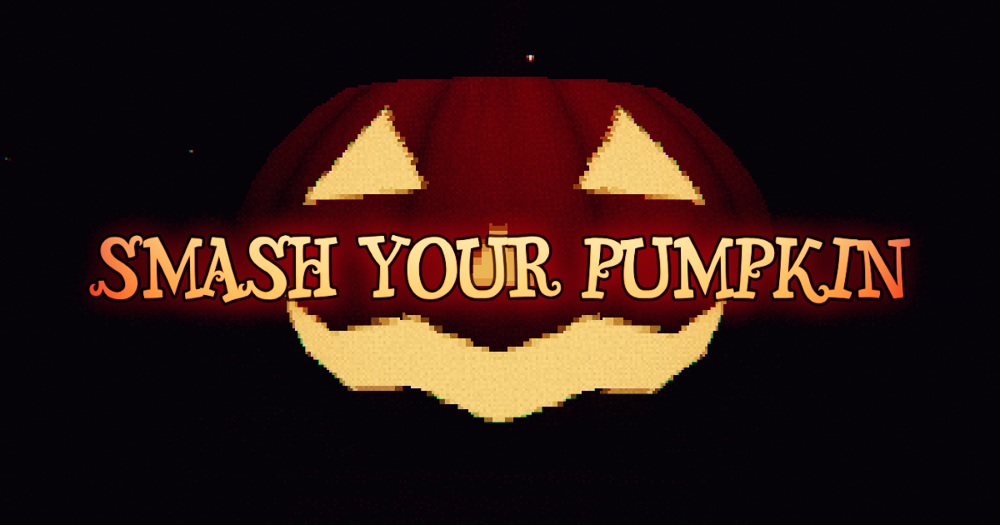

# Smash Your Pumpkin



**Play:** https://lucaargentieri.github.io/smash-your-pumpkin/

A Halloween rage room, successor to [paint-your-pumpkin](https://github.com/LucaArgentieri/paint-your-pumpkin).
You sit at a table in a candlelit cabin and have 60 seconds to smash as many pumpkins as you can.

There is no tutorial: the weapons (keys 1–3, mouse wheel, or the slots at the bottom) are meant to be
figured out by playing. The pointer becomes the selected weapon and swings with every blow. For
reference:

- **Fist**: fast, cracks a pumpkin in three hits and grinds small shards into **dust** for a bonus.
- **Mallet**: slow, shatters a whole pumpkin in one blow, pumpkin bonus x2.
- **Axe**: cuts pumpkins and shards in two, x2 points per piece.

### The combo

The combo is where high scores come from:

- Every hit inside the combo window extends it and raises the point multiplier (up to x3).
- Switching weapon mid-combo adds +2.
- The window tightens as the combo grows (1.1 s down to 0.55 s). Instead of a timer bar, a pixelated
  wall of fire closes in from the screen edges as the window runs out, charring the room behind it and
  throbbing red when time is nearly gone. Banking the combo makes it flare; a miss snuffs it dull red.
- Let it run out and it is **cashed in** for combo² × 3 points. Click empty table and it **breaks** for nothing.
- Ranks: WICKED (5), GRIM (10), GHASTLY (20), UNHOLY (35), DAMNED (50), APOCALYPTIC (80).
- The best score and the combo record are kept in the browser.
- Like Balatro, the numbers escalate with the combo: count, multiplier, rank, score popups and the
  cash-out grow, glow hotter, sway and, past half heat, tremble. The score rolls up rather than jumping.

The results screen (where the leaderboard will live) switches to a low camera over the pumpkin's
shoulder while it turns to gaze at the moon, drifting slowly like an arcade attract mode.

Holding the button keeps swinging (held swings never break the combo), and near misses still count, which
helps on touch screens. Tuning lives in `COMBO` and `TOOLS` in `src/config.js`.

## Sound

Everything is synthesised with Web Audio in `src/audio/Sound.js`, so there are no audio files:

- **Music**: a low, driving loop to vent on: a distorted bass riff in A minor over a heavy kick and a
  dark drone. As the combo heats up, double kicks, a snare and distorted power-chord stabs come in and
  the filter opens.
- **Hits**: a short, clean "thock" (click transient plus a falling low body), weighted differently for
  fist, mallet and axe, with a short dark splat on pumpkin. A pumpkin bursting gets a deep crunch and a
  dust grind gets a sparkle.
- **Combo**: every hit in a combo rings the next note up the A minor pentatonic, starting low at A2.
  Rank ups add an arpeggio, switching weapon adds a bling, a cash-out is a cascade that lands on a low
  power chord and a broken combo is a sad wah-wah.
- **Round**: stingers for READY / SMASH / TIME'S UP and a clock tick in the last ten seconds.

Audio starts on the first click or key press (browser autoplay rules). **M**, or the label in the
top-right corner of the title and results screens, toggles it, and the choice is remembered.

## Look

The key art is an homage to the [Inscryption](https://www.inscryption.com/) cover: the game's own scene in its
`?cover` mode (a carved pumpkin looming over a narrow lens, only the title on top), rendered by
`node scripts/render-cover.mjs`.


PS1 era on purpose, at every quality tier: a 200-line scene upscaled without filtering, vertices
snapped to that pixel grid (the wobble when the camera moves), affine texture mapping, unfiltered
textures and low-poly props (`src/core/retro.js`), plus dithering and grain on the scene only.

## Credits

- Title font: [Snidely](https://typodermicfonts.com/) by Typodermic Fonts (Ray Larabie), released into the
  public domain (CC0) and bundled in `public/fonts/`.
- Number and UI fonts: Jacquard 24 and Pixelify Sans from Google Fonts (SIL Open Font License).

## Stack

- three.js `WebGPURenderer` (falls back to WebGL2) with TSL for every material and for post-processing
- [three-pinata](https://github.com/dgreenheck/three-pinata) for Voronoi fracturing and slicing, run in Web Workers
- [Rapier](https://rapier.rs) for physics
- All UI is drawn in WebGL: canvas-painted panels that burn in and out through a TSL shader

## Develop

```bash
bun install   # or npm install
bun run dev
```

In dev builds the game instance is exposed as `window.game`, for example `game.timeLeft = 1` ends the round.

## Leaderboard (Supabase)

A three-letter arcade name and a top 100 board, stored in Supabase.

1. Create a Supabase project and run [`supabase/schema.sql`](supabase/schema.sql) in its SQL editor. It
   creates the `scores` table (public read only), and the `submit_score` function, which validates the
   entry, throttles repeats and trims the board to 100 rows.
2. Copy the project URL and the **anon public** key (Project Settings > API).
3. Put them in `.env.production` (committed, they are public by design) for the deployed game, or
   in `.env.local` (copy `.env.example`) for local development.

The board can also be opened from the title screen (LEADERBOARD, or **L**).

Without them the game runs offline: no name entry, no board. The anon key is meant to be public;
the database only allows reading the board and calling `submit_score`. A browser game can't fully
stop forged scores, so the function only rejects implausible ones (tighten its limits once real scores exist).

## Deploy

**GitHub Pages**: every push to `main` runs `.github/workflows/deploy.yml`, which builds with
`BASE_PATH=/<repo>/` and publishes `dist/` to the `gh-pages` branch. In the repository settings,
Pages must serve from the `gh-pages` branch (root).

**Netlify** also works: `netlify.toml` builds with `npm run build` and publishes `dist/` at the site root.

## Project layout

| Path | What |
| --- | --- |
| `src/config.js` | Tools, scoring, timings, palette, fonts and all on-screen text |
| `src/game/Game.js` | Round flow, input, scoring, camera |
| `src/game/Destruction.js` | Hits → fractures / slices / dust, shard lifetime |
| `src/pumpkins/` | Pumpkin set (`variants.js`), GLB loading (`models.js`), TSL materials |
| `src/world/Cabin.js` | Table, candles, moon, dust, lights |
| `src/core/` | Renderer + post chain, quality tiers, physics, fracture worker pool, tweens |
| `src/ui/` | Burn-in UI panels, tool cards, HUD and screens |

| `scripts/build-placeholders.mjs` | Generates the placeholder pumpkin GLBs |
| `scripts/render-cover.mjs` | Renders the key art (`public/og.png`) and the favicon / touch icon from the game's `?cover` mode |
| `supabase/schema.sql` | Leaderboard table, policies and `submit_score` |

## Performance

The game picks a quality tier at startup from the GPU and device hints, then **steps down
automatically** when frames run slower than 45 fps for about 4 seconds. Players can override it by
clicking the label in the corner of the title and results screens, or by pressing **Q**. The choice is
saved in the browser.

| Tier | Pixel ratio (UI sharpness) | Bloom | Shadows | Candle lights | Max shards |
| --- | --- | --- | --- | --- | --- |
| MIN | ≥ 1.25 | off | off | 0 | 50 |
| LOW | ≤ 1.5 | off | off | 0 | 80 |
| MED | ≤ 2 | ¼ res | lantern | 1 | 150 |
| HIGH | ≤ 2 | ½ res | lantern + moon | 3 | 220 |

Other measures that apply to every tier:

- The 3D scene is always rendered at a PS1-like resolution (`RETRO.lines` = 200 pixels across the
  shorter screen side, in `src/config.js`), which is the look and also the biggest saving.
- Procedural textures (table, moon) are baked once at load instead of computing noise for every pixel.
- Voronoi fracturing runs in Web Workers; each pumpkin is pre-fractured while it drops onto the table.
- Shaders compile during loading (hidden warm-up draws), not on the first hit.
- Idle particles, burnt-out UI panels and finished dissolve effects are skipped entirely.
- Light and shadow changes, which recompile shaders, wait until the round ends.
- Scores are normalised by the tier's fracture detail, so lower tiers aren't penalised.

## Pumpkin models

See [docs/pumpkin-models.md](docs/pumpkin-models.md) for the model requirements, prompts to generate
the set, and how to optimise generated models.
